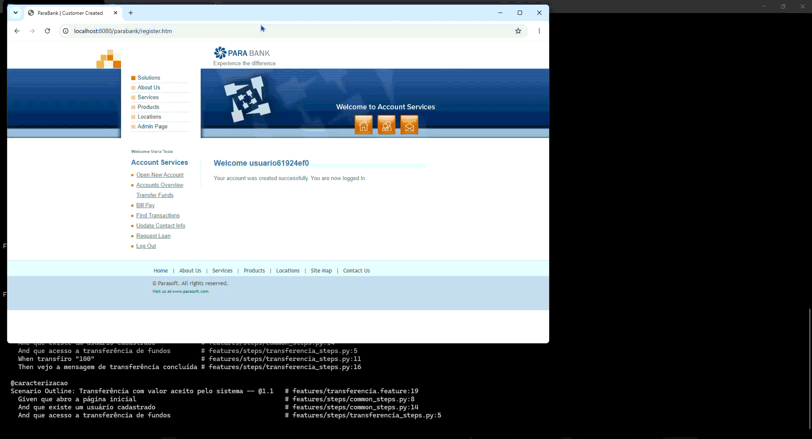
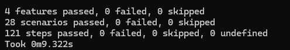

# Automação de testes BDD: ParaBank

[](https://github.com/LucasRoMatos/automacao-parabank-bdd/actions/workflows/testes.yml)

Testes automatizados das funcionalidades de **registro**, **login** e **transferência de fundos** da aplicação de demonstração ParaBank. Os cenários são escritos em Gherkin com Behave, e a automação do navegador usa Playwright, com o padrão Page Object.

## Evidências do funcionamento

### Executando todos os testes localmente


### Resumo da execução


## Tecnologias

- Python 3.12+
- Behave (BDD, cenários em Gherkin)
- Playwright (automação do navegador)

## Pré-requisitos

- Python 3.12 ou superior
- Git
- Docker Desktop, para o ambiente local (recomendado)

## Instalação

```powershell
git clone https://github.com/LucasRoMatos/automacao-parabank-bdd.git
cd automacao-parabank-bdd
python -m venv .venv
.venv\Scripts\Activate.ps1
pip install -r requirements.txt
playwright install chromium
```

## Ambiente de execução

Os testes usam a URL definida na variável `PARABANK_URL`. Se a variável não estiver definida, usam o site público.

### Ambiente local (recomendado)

Antes de tudo, abra o Docker Desktop e aguarde iniciar.

No PowerShell, rode:

```powershell
docker run -d -p 8080:8080 parasoft/parabank
$env:PARABANK_URL="http://localhost:8080/parabank"
```

Aguarde um ou dois minutos após o `docker run` antes de rodar os testes. Para confirmar que a aplicação subiu, abra `http://localhost:8080/parabank` no navegador.

A variável `PARABANK_URL` vale somente para o terminal em que foi definida. Se abrir outro terminal, defina de novo.

Em bash, zsh ou Git Bash, use:

```bash
docker run -d -p 8080:8080 parasoft/parabank
export PARABANK_URL="http://localhost:8080/parabank"
```

### Site público (padrão)

Usado quando `PARABANK_URL` não está definida: `https://parabank.parasoft.com/parabank`.

Esse site é instável. Pode responder com erro interno a operações válidas, e pode exibir o desafio "Confirme que é humano" da Cloudflare, que impede a automação. Nesses casos a falha não vem do código. Por isso o ambiente local é a forma recomendada de execução.

## Execução

Rodar todos os cenários:

```powershell
python -m behave
```

Rodar uma funcionalidade:

```powershell
python -m behave features/registro.feature
python -m behave features/login.feature
python -m behave features/transferencia.feature
```

Rodar sem os cenários de caracterização (ver a seção abaixo):

```powershell
python -m behave --tags=~@caracterizacao
```

## Integração contínua

Como um plus, implementei esse integração que a cada push ou pull request, o GitHub Actions executa a suíte completa automaticamente. O workflow (`.github/workflows/testes.yml`):

- sobe o ParaBank em contêiner como serviço do job;
- aguarda a aplicação responder antes de iniciar os testes;
- executa o Behave em modo headless, sem interface gráfica;
- publica a saída da execução como artefato, disponível na aba Actions.

A execução também pode ser disparada manualmente pela aba Actions, na opção "Run workflow".

## Cenários de caracterização

Cenários marcados com `@caracterizacao` documentam **o comportamento atual da aplicação**, e não um requisito validado. Não existe especificação formal para essas situações. Por isso, o critério de aceite adotado é o que o sistema faz hoje, observado na exploração manual.

Eles servem para:

- registrar comportamentos que deveriam ser reportados como problema, sem tratá-los como corretos;
- detectar mudanças: se o comportamento mudar, o cenário falha e avisa;
- deixar documentado o que foi observado e como foi testado.

Comportamentos documentados:

- **Acesso à página de contas sem sessão:** a aplicação mostra "An internal error has occurred and has been logged." em vez de redirecionar para o login.
- **Transferência com valor zero ou negativo:** a aplicação aceita e mostra "Transfer Complete!".
- **Transferência com valor não numérico ou campo vazio:** a aplicação mostra "An internal error has occurred and has been logged.", sem mensagem de validação.

Se uma regra de negócio for definida para essas situações, o cenário deve ser reescrito para verificar a regra e a tag `@caracterizacao` deve ser removida.

## Estrutura do projeto

```
features/          cenários em Gherkin e configuração de hooks (environment.py)
features/steps/    passos que traduzem o Gherkin em ações nas páginas
pages/             Page Objects: seletores e ações de cada tela
support/           geração de dados de teste
config.py          URL base da aplicação
evidencias/        saídas de execução e screenshots de falhas
```

## Evidências

Para salvar uma nova saída de uma execução:

```powershell
python -m behave > evidencias/execucao.txt
```

## Limitações

- O site público pode exibir o desafio da Cloudflare e responder com erro interno de forma intermitente.
- O site público é uma demonstração, e seus dados podem ser reiniciados sem aviso.
- Cada execução cria um usuário novo, com nome único, então os testes não dependem de dados existentes.
